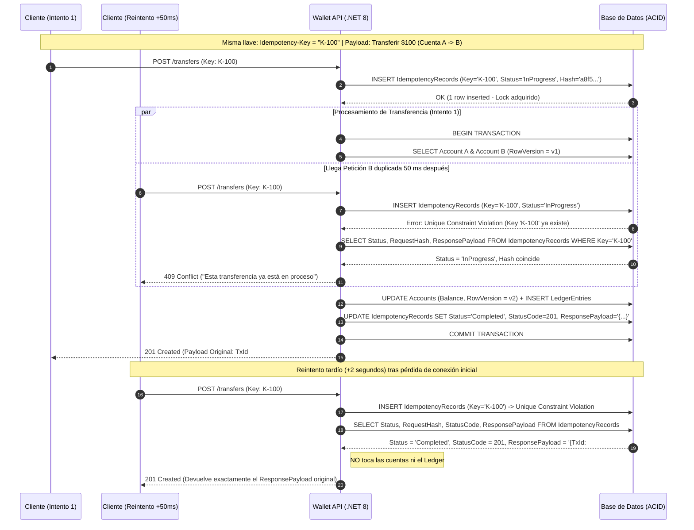
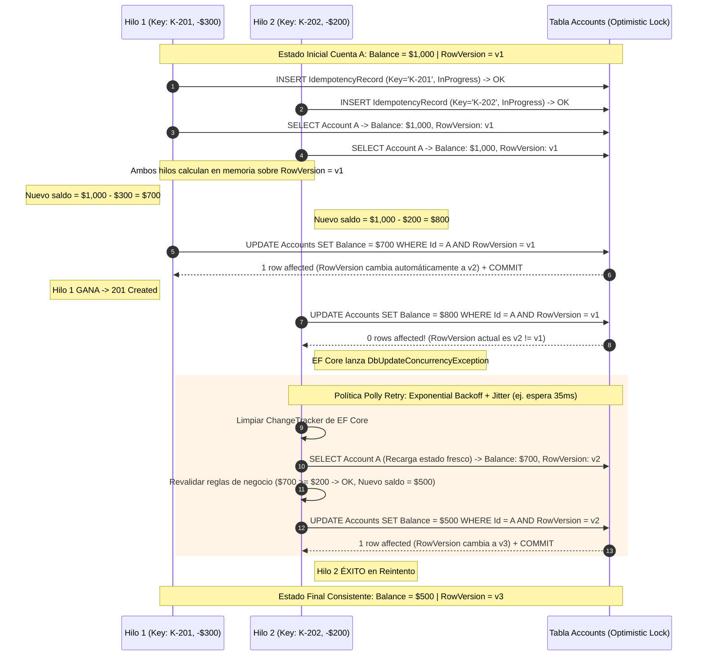
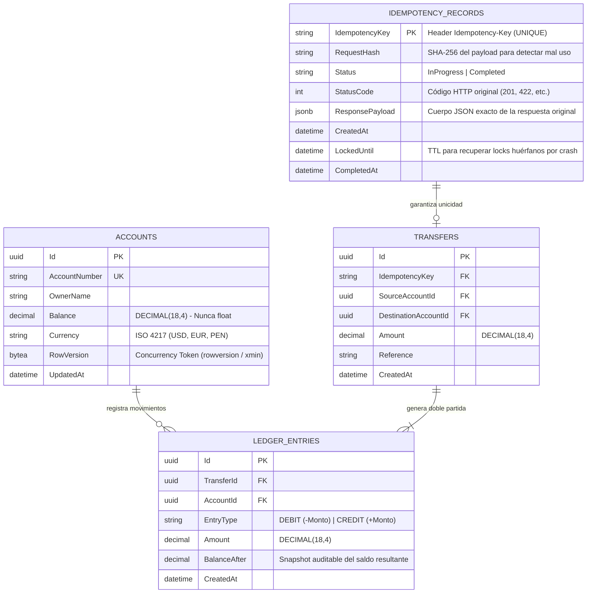

# Atomic Wallet Service — Idempotency & Concurrency Control in .NET 8

Servicio transaccional de billetera digital y transferencias financieras construido con **.NET 8**, diseñado para garantizar **consistencia fuerte**, **ejecución exactamente una vez (*exactly-once semantics* a nivel de negocio)** y **alta concurrencia sin bloqueos de base de datos**.

Este proyecto implementa los patrones estándar de la industria financiera y pasarelas de pago (inspirado en especificaciones como el draft *IETF `Idempotency-Key` HTTP Header* y arquitecturas de Stripe/Adyen) para resolver dos problemas críticos en sistemas distribuidos bancarios:
1. **Peticiones duplicadas** por reintentos de red, *timeouts* o doble clic del cliente (**Idempotencia Atómica**).
2. **Condiciones de carrera (*Race Conditions*)** y **Sobregiros (*Double-Spending*)** cuando múltiples hilos operan sobre la misma cuenta simultáneamente (**Control de Concurrencia Optimista + Resiliencia con Backoff Exponencial y Jitter**).

---

## Tabla de Contenidos

- [Arquitectura y Patrones Clave](#arquitectura-y-patrones-clave)
- [Flujo Visual: Petición Duplicada vs. Petición Concurrente](#flujo-visual-petición-duplicada-vs-petición-concurrente)
  - [Escenario A: Petición Duplicada (Idempotencia)](#escenario-a-petición-duplicada-idempotencia)
  - [Escenario B: Peticiones Concurrentes Distintas (Control Optimista)](#escenario-b-peticiones-concurrentes-distintas-control-optimista)
- [Decisión Arquitectónica: Bloqueo Optimista vs. Bloqueo Pesimista](#decisión-arquitectónica-bloqueo-optimista-vs-bloqueo-pesimista)
- [Modelo de Datos](#modelo-de-datos)
- [Matriz de Respuestas HTTP (Semántica de Idempotencia)](#matriz-de-respuestas-http-semántica-de-idempotencia)
- [Stack Tecnológico](#stack-tecnológico)
- [Ejecución y Pruebas de Estrés](#ejecución-y-pruebas-de-estrés)

---

## Arquitectura y Patrones Clave

### 1. Idempotencia Atómica (*First-Write-Wins Lock*)
En lugar del antipatrón `SELECT` y luego `INSERT` (vulnerable a condiciones de carrera *TOCTOU - Time-Of-Check to Time-Of-Use*), el servicio utiliza una operación atómica de reclamación de llave:
- Al recibir el header `Idempotency-Key`, se intenta insertar directamente un registro con estado `InProgress`, un hash `SHA-256` del payload (`RequestHash`) y una ventana de expiración de bloqueo (`LockedUntil`).
- La restricción `UNIQUE` de la base de datos (o `SET key NX EX` en entornos con caché distribuida Redis) garantiza que **solo un hilo** pueda reclamar la llave, sin ventana de carrera.
- La actualización del registro de idempotencia a `Completed` (junto con el `ResponsePayload` serializado y el `StatusCode`) ocurre **dentro de la misma transacción ACID** que debita/acredita las cuentas y registra el asiento contable (*Ledger*).

### 2. Control de Concurrencia Optimista (*OCC*) con Reintentos Inteligentes
- La tabla `Accounts` incorpora un token de versión de fila (`RowVersion` en SQL Server / `xmin` en PostgreSQL).
- Al confirmar una transferencia, Entity Framework Core ejecuta:
  ```sql
  UPDATE Accounts
  SET Balance = @NewBalance, UpdatedAt = @Now
  WHERE Id = @AccountId AND RowVersion = @ExpectedRowVersion;
  ```
- Si otro hilo modificó el saldo milisegundos antes, la consulta afecta a `0` filas y lanza `DbUpdateConcurrencyException`.
- Una política de resiliencia (**Polly v8**) captura la excepción, limpia el `ChangeTracker`, **recarga el saldo fresco**, **revalida las reglas de negocio** (ej. fondos suficientes) y reintenta aplicando **Exponential Backoff + Decorrelated Jitter** para evitar tormentas de colisiones.

### 3. Contabilidad de Doble Entrada Inmutable (*Double-Entry Ledger*)
- Ningún cambio de saldo ocurre de forma aislada. Cada transferencia genera asientos inmutables (`Debit` y `Credit`) en `LedgerEntries` dentro de la misma unidad de trabajo, garantizando trazabilidad y auditoría financiera completa.

---

## Flujo Visual: Petición Duplicada vs. Petición Concurrente

Es fundamental distinguir entre **dos peticiones que representan la misma intención de negocio** (duplicadas, misma `Idempotency-Key`) y **dos operaciones distintas que compiten por el mismo recurso** (concurrentes, diferente `Idempotency-Key` sobre la misma cuenta).

### Escenario A: Petición Duplicada (Idempotencia)
> **Caso de uso:** La app móvil envía una transferencia de `$100.00` con `Idempotency-Key: K-100`. Debido a latencia en la red móvil, el cliente o gateway reintenta exactamente la misma petición `50 ms` después, y una tercera vez `2 s` después.



---

### Escenario B: Peticiones Concurrentes Distintas (Control Optimista)
> **Caso de uso:** Una cuenta empresarial (`Cuenta A`, saldo `$1,000.00`) recibe simultáneamente dos cobros legítimos y **distintos**:
> - **Hilo 1 (`Key: K-201`):** Pago de nómina por `$300.00`.
> - **Hilo 2 (`Key: K-202`):** Pago a proveedor por `$200.00`.
> Ambos son operaciones válidas y **ambos deben procesarse** sin perder actualizaciones (*Lost Update Problem*) para que el saldo final sea exactamente `$500.00`.



---

## Decisión Arquitectónica: Bloqueo Optimista vs. Bloqueo Pesimista

En sistemas transaccionales bancarios existen dos estrategias principales para serializar mutaciones de saldo en cuentas. Este proyecto implementa **Bloqueo Optimista (`rowversion` / `xmin`)** sobre **Bloqueo Pesimista (`SELECT ... FOR UPDATE` / `UPDLOCK`)** por las siguientes razones de ingeniería:

| Criterio | Bloqueo Optimista (`rowversion` / `xmin`) | Bloqueo Pesimista (`SELECT ... FOR UPDATE`) |
| :--- | :--- | :--- |
| **Mecanismo** | No bloquea filas al leer. Verifica al hacer `UPDATE` que la versión (`RowVersion`) no haya cambiado desde la lectura. | Adquiere un bloqueo exclusivo (`X` / `U` lock) en el motor de BD desde el `SELECT` hasta el `COMMIT`/`ROLLBACK`. |
| **Riesgo de Deadlocks** | **Nulo en lecturas.** Al no retener locks durante el cálculo de negocio, evita los clásicos *AB-BA Deadlocks* en transferencias cruzadas (`Cuenta A -> B` y `Cuenta B -> A` simultáneas). | **Alto** si las cuentas no se bloquean en un orden determinista estricto (ej. ordenar `AccountId` ascendente antes del `SELECT FOR UPDATE`). |
| **Throughput y Escalabilidad** | **Muy Alto.** Las conexiones no quedan esperando en cola de locks en el motor SQL; el pool de hilos de .NET y las conexiones de BD se liberan rápido. | **Menor bajo carga.** Los hilos bloqueados retienen conexiones activas del pool, pudiendo causar *Connection Pool Starvation* si una transacción tarda. |
| **Comportamiento ante Colisión** | Falla rápido (`0 rows affected`) y se recupera en milisegundos mediante *Exponential Backoff + Jitter*. | Encola las peticiones dentro del motor de base de datos hasta que venza el `lock_timeout`. |
| **Escenario Ideal en Banca** | **Cuentas retail, billeteras P2P y cuentas corporativas estándar**, donde la probabilidad de que dos transacciones golpeen la misma cuenta en el mismo milisegundo es baja a moderada. | **Cuentas "calientes" (*Hot Accounts*)** de altísima contención (ej. cuenta concentradora de un gran comercio con miles de cobros por segundo), o mediante particionamiento de saldos (*Sharded Counters* / *Append-Only Ledger*). |

> **Nota sobre Prevención de Deadlocks:** Incluso en operaciones que actualizan dos cuentas (`Origen` y `Destino`) dentro de una misma transacción, el servicio ordena las operaciones por `AccountId` de forma determinista para eliminar cualquier posibilidad de interbloqueo a nivel de página o fila durante el `COMMIT`.

---

## Modelo de Datos



---

## Matriz de Respuestas HTTP (Semántica de Idempotencia)

El servicio implementa una validación estricta del ciclo de vida de la llave de idempotencia para cubrir todos los casos borde de producción:

| Estado de `IdempotencyKey` | Condición Adicional | Respuesta HTTP | Acción del Sistema |
| :--- | :--- | :--- | :--- |
| **No existe** | Payload válido | `201 Created` | Inserta llave en `InProgress`, ejecuta transferencia, guarda respuesta y cambia a `Completed` en la misma transacción. |
| **Existe (`InProgress`)** | `LockedUntil > UTCNow` y mismo `RequestHash` | `409 Conflict` | Indica al cliente que la operación original sigue en vuelo (`"Esta transferencia ya está en proceso"`). No toca las cuentas. |
| **Existe (`InProgress`)** | `LockedUntil < UTCNow` (Crash previo del servidor) | `201 Created` | Toma posesión del lock huérfano expirado y reejecuta la transferencia de forma segura. |
| **Existe (`Completed`)** | Mismo `RequestHash` | `200 OK` / `201 Created` | **Short-circuit:** Devuelve instantáneamente el `ResponsePayload` y `StatusCode` almacenados sin tocar cuentas ni ejecutar lógica de negocio. |
| **Existe (`InProgress` o `Completed`)** | **Diferente `RequestHash`** | `422 Unprocessable Entity` | Rechaza la petición por reutilización inválida de una misma llave con parámetros distintos (protección contra bugs del cliente). |
| **No existe** | Fallo de regla de negocio (ej. Saldo Insuficiente) | `422 Unprocessable Entity` | Registra el resultado determinista o libera la llave según política, garantizando que nunca se cobre dos veces. |
| **No existe** | Contención extrema tras agotar reintentos de Polly | `503 Service Unavailable` | Hace rollback y elimina/libera el registro `InProgress` para permitir que el cliente reintente con la misma `Idempotency-Key`. |

---

## Stack Tecnológico

- **Arquitectura:** Vertical Slice Architecture (organizado por *Features* de negocio, alta cohesión y bajo acoplamiento)
- **Runtime & Framework:** .NET 8 (ASP.NET Core Minimal APIs)
- **Base de Datos & ORM:** SQL Server 2022 (en Docker) + Entity Framework Core 8 (`rowversion` nativo y manejo de errores SQL `2627`/`2601`)
- **Resiliencia:** `Microsoft.Extensions.Resilience` / **Polly v8** (Retry Pipeline con *Exponential Backoff + Decorrelated Jitter* para `DbUpdateConcurrencyException`)
- **Validación & Errores:** FluentValidation + ProblemDetails (RFC 9457)
- **Testing:** xUnit, FluentAssertions y pruebas de concurrencia real lanzando múltiples hilos paralelos (`Task.WhenAll`) contra SQL Server

---

## Ejecución y Pruebas de Estrés

### Requisitos Previos
- [.NET 8 SDK](https://dotnet.microsoft.com/download/dotnet/8.0)
- [Docker Desktop](https://www.docker.com/products/docker-desktop/) (para levantar la instancia de SQL Server 2022)

### Comandos Rápidos

```bash
# 1. Levantar SQL Server 2022 en Docker
docker compose up -d

# 2. Restaurar dependencias y aplicar migraciones
dotnet build
dotnet ef database update --project src/AtomicWallet.Api

# 3. Ejecutar la suite de pruebas (incluye tests de colisión de concurrencia e idempotencia)
dotnet test --logger "console;verbosity=detailed"

# 4. Iniciar la API
dotnet run --project src/AtomicWallet.Api
```

### Ejemplo de Petición Idempotente

```http
POST /api/v1/transfers HTTP/1.1
Host: localhost:5000
Content-Type: application/json
Idempotency-Key: 8f14e45f-ceea-467a-a824-5c34168417f8

{
  "sourceAccountId": "11111111-1111-1111-1111-111111111111",
  "destinationAccountId": "22222222-2222-2222-2222-222222222222",
  "amount": 150.00,
  "currency": "USD",
  "reference": "Pago de factura #4092"
}
```
